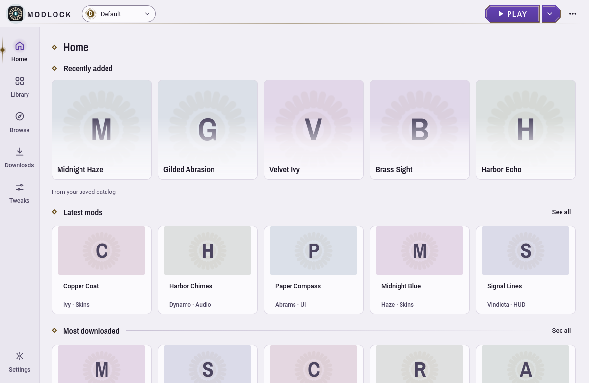
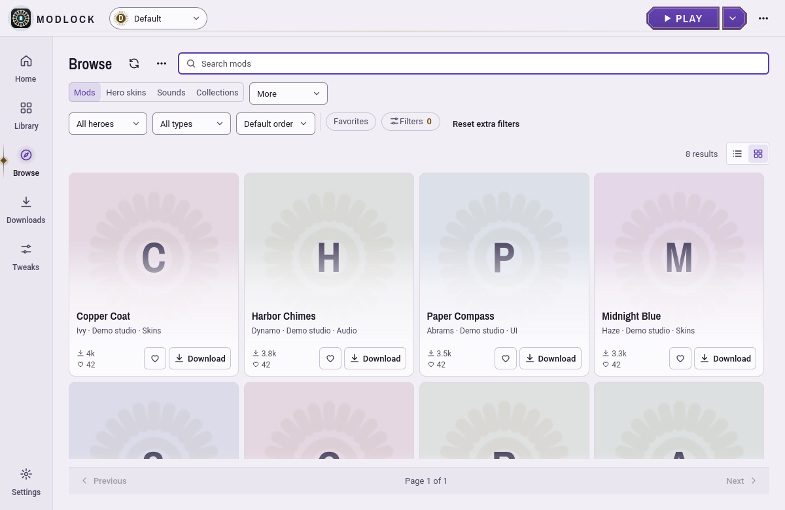

# Modlock

Modlock is a native Linux mod manager for Deadlock. Browse GameBanana, import local mods and switch between profiles from one app.

<picture>
  <source media="(prefers-color-scheme: dark)" srcset="docs/screenshots/home-dark.png">
  
</picture>

- **Manage mods.** Turn mods on or off, choose files and set their load order. Modlock can apply supported changes automatically while Deadlock is closed. Some changes need your review.
- **Share profiles.** Export a code with your mod selection and load order. Review a code before importing it.
- **Repair supported mods after a game update.** Modlock prepares fixes for known problems. Some mods still need an update from their author.
- **Tune the game.** Choose a performance preset, edit your crosshair, or review and save console commands.
- **Bring your existing library.** Import local VPKs, archives, or mods already installed in the game folder.

<picture>
  <source media="(prefers-color-scheme: dark)" srcset="docs/screenshots/browse-dark.png">
  
</picture>

The screenshots use fictional listings and Modlock’s own thumbnail placeholders. View the light versions of [Home](docs/screenshots/home.png) and [Browse](docs/screenshots/browse.png).

## Run Modlock

Modlock is in early development. We test on **x86-64 openSUSE Tumbleweed**.

If the [Releases page](../../releases) offers an x86-64 AppImage, download it and rename it to `Modlock-x86_64.AppImage`. From the download folder, run:

```sh
chmod +x Modlock-x86_64.AppImage
./Modlock-x86_64.AppImage
```

To try the interface with a sample library, run `./Modlock-x86_64.AppImage --demo`. For your own mods, start Modlock normally. It looks for Deadlock in your Steam libraries. If detection misses it, choose the game folder in Settings.

**Launcher and GameBanana 1-Click links are optional.** Download the source for the same release and open a terminal in its top-level folder. If you saved the renamed AppImage in Downloads, run:

```sh
tools/install-appimage.sh "$HOME/Downloads/Modlock-x86_64.AppImage"
```

The installer copies Modlock to your Applications folder and registers it in your desktop menu. To import ZIP, 7-Zip or RAR files, install your distribution’s `unar` package, which provides `unar` and `lsar`.

## Build from source

Install the [build dependencies](CONTRIBUTING.md#build-dependencies), then run:

```sh
cmake -S . -B build -G Ninja -DCMAKE_BUILD_TYPE=Release -DBUILD_TESTING=OFF
cmake --build build --target modlock --parallel 2
./build/modlock
```

Cargo uses the Rust dependencies included in the repository. The source build works offline once the system dependencies are installed.

## Game files and privacy

Close Deadlock before applying or restoring a setup. **Restore previous setup** is available when Modlock can verify the previous Apply. Crosshair and autoexec saves have their own review, backup and undo. Existing libraries keep their locations. [How Modlock changes the game](docs/how-it-works.md)

Browse and downloads use GameBanana. Modlock generates profile codes locally. During export, it can send a package fingerprint to `api.deadlockmods.app` to identify an exact file. You choose whether to include names of local-only mods in the code. [Profile sharing](docs/profile-sharing/README.md)

## Credits and license

Modlock is an unofficial Linux port of [Deadlock Mod Manager](https://github.com/deadlock-mod-manager/deadlock-mod-manager) by Stormix and contributors. Mod authors retain the rights to their work. Deadlock is a trademark of Valve Corporation. Modlock is independent of Valve, GameBanana and the Deadlock Mod Manager team.

Modlock is free software under the [GNU General Public License, version 3](LICENSE). See the [third-party notices](THIRD-PARTY-NOTICES.md) for bundled components and the [contributor guide](CONTRIBUTING.md) to report a bug or submit a change.
